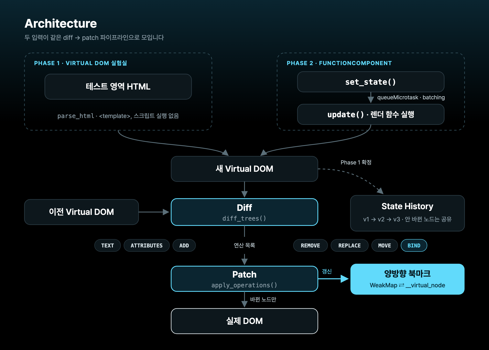
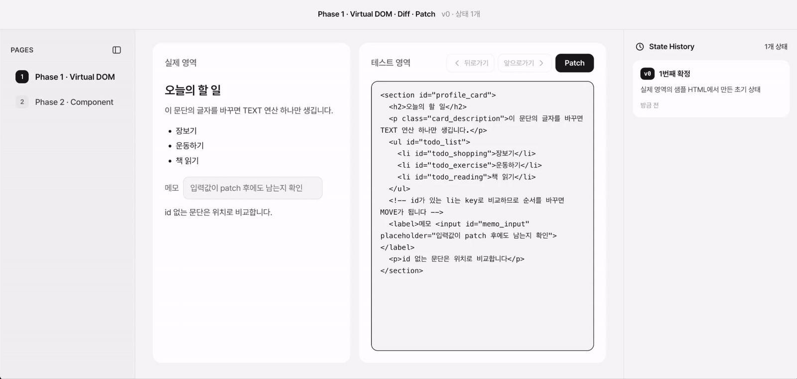
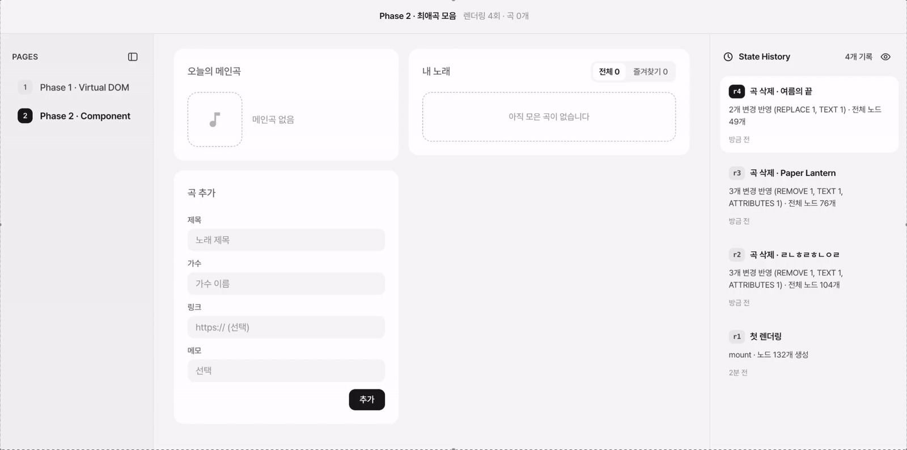
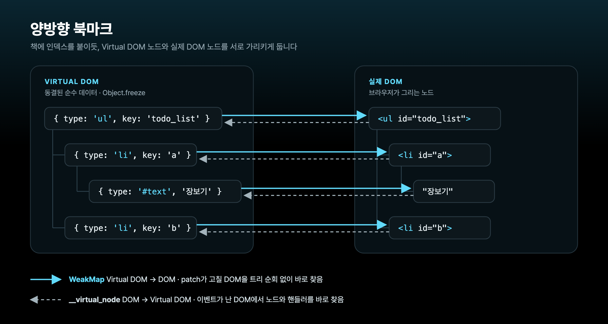

<div align="center">


<p>
  <a href="#아키텍처"><b>아키텍처</b></a> ·
  <a href="#phase-1--virtual-dom--diff--patch"><b>Phase 1</b></a> ·
  <a href="#phase-2--component--state--hooks"><b>Phase 2</b></a> ·
  <a href="#차별화--양방향-북마크"><b>차별화: 양방향 북마크</b></a> ·
  <a href="#실제-react와-비교"><b>React와 비교</b></a> ·
  <a href="#벤치마크"><b>벤치마크</b></a> ·
  <a href="#ai-활용-방식"><b>AI 활용</b></a>
</p>

</div>

**Virtual DOM 노드와 실제 DOM 노드를 서로 가리키는 북마크로, 고칠 DOM과 불릴 핸들러를 바로 찾습니다.** Mini React는 화면을 Virtual DOM으로 들고 있다가 두 트리의 차이만 실제 DOM에 반영합니다. 북마크는 노드 객체에 묶여 있어서, 바뀌지 않은 부분의 노드 객체를 다음 렌더링에서도 그대로 쓰면 연결도 그대로 유지됩니다. 그래서 바뀌지 않은 행은 비교도, 북마크 갱신도 건너뜁니다. ([차별화](#차별화--양방향-북마크))

## 목차

- [아키텍처](#아키텍처)
- [핵심 로직](#핵심-로직)
  - [Phase 1 — Virtual DOM · Diff · Patch](#phase-1--virtual-dom--diff--patch)
  - [Phase 2 — Component · State · Hooks](#phase-2--component--state--hooks)
- [차별화 — 양방향 북마크](#차별화--양방향-북마크)
- [사용법](#사용법)
- [테스트](#테스트)
- [실제 React와 비교](#실제-react와-비교)
- [벤치마크](#벤치마크)
- [AI 활용 방식](#ai-활용-방식)

## 아키텍처

<p align="center">
  
</p>

| 모듈                                                 | 하는 일                                                            |
| ---------------------------------------------------- | ------------------------------------------------------------------ |
| [`virtual_node.js`](src/virtual_node.js)             | 노드 정의, 실제 DOM → Virtual DOM 변환, 위험한 요소·attribute 차단 |
| [`parse_html.js`](src/parse_html.js)                 | HTML 문자열 → Virtual DOM (`<template>` 사용, 스크립트 실행 없음)  |
| [`diff.js`](src/diff.js)                             | 두 트리를 비교해 연산 목록 생성, 노드 공유                         |
| [`patch.js`](src/patch.js)                           | 연산을 실제 DOM에 적용, 양방향 북마크 관리                         |
| [`state_history.js`](src/state_history.js)           | 뒤로·앞으로·갈래 버리기 (최대 50개)                                |
| [`operation_summary.js`](src/operation_summary.js)   | 연산 목록 → `2개 변경 반영 (TEXT 1, ADD 1)`                        |
| [`function_component.js`](src/function_component.js) | `FunctionComponent`와 Hooks                                        |
| [`view_builder.js`](src/view_builder.js)             | `create_view_element`, 이벤트 핸들러 보관                          |
| [`song_board.js`](src/song_board.js)                 | Phase 2 예제 앱 (최애곡 모음)                                      |

## 핵심 로직

### Phase 1 — Virtual DOM · Diff · Patch

<p align="center">
  
  <br />
  <sub>테스트 영역에서 HTML을 고치고 <b>Patch</b> → 바뀐 노드만 실제 영역에 반영되고 하이라이트됩니다. 오른쪽 State History로 뒤로·앞으로 이동합니다.</sub>
</p>

```
  HTML → Virtual DOM → Diff → Patch → 실제 DOM
```

- **Virtual DOM** — 모든 노드는 `Object.freeze`로 동결한 순수 데이터이고, 바뀌면 새 노드를 만듭니다. `id`가 있으면 key로 씁니다. 텍스트도 객체입니다(북마크로 쓰는 `WeakMap`은 객체만 키로 받습니다).

  ```js
  { type: 'li',    key: 'a',  attributes: { id: 'a' }, children: [...], namespace: null }
  { type: '#text', key: null, text: '안녕' }
  ```

- **Diff** — 아래 표의 연산을 만듭니다. 자식은 `id`가 같은 것끼리 → 내용이 완전히 같은 것끼리 → 남은 것은 위치대로 짝짓습니다. 두 번째 단계 덕분에 들여쓰기 공백 하나로 뒤쪽 노드가 전부 바뀐 것으로 잡히지 않습니다.
- **Patch** — 연산이 가리키는 이전 노드로 북마크를 조회해 DOM을 고칩니다. ([차별화](#차별화--양방향-북마크))
- **안전한 변환** — `script`, `base`, `meta`, `object`, `embed` 요소와 `on*` attribute, `javascript:` URL은 변환 단계에서 제외합니다.
- **State History** — 브라우저처럼 뒤로·앞으로 이동하고, 뒤로 간 상태에서 고쳐서 Patch하면 그 뒤의 이력을 버립니다(v1 → v2 → v3에서 v2로 가서 고치면 v1 → v2 → v4). 바뀌지 않은 노드는 이전 트리와 같은 객체를 공유하고, 최대 50개까지 보관합니다.

#### Diff 케이스

과제의 기본 5가지 케이스(`ADD`, `REMOVE`, `REPLACE`, `TEXT`, `PROPS`)에 `MOVE`와 `BIND`를 더해 7가지 연산을 만듭니다. `PROPS`는 구현 이름이 `ATTRIBUTES`입니다.

| 케이스         | 언제                                            | Phase 2 예제 앱에서                   |
| -------------- | ----------------------------------------------- | ------------------------------------- |
| `ADD`          | 새 노드가 생김                                  | 곡 추가                               |
| `REMOVE`       | 노드가 사라짐                                   | 곡 삭제                               |
| `REPLACE`      | 같은 자리의 노드 종류(태그)가 바뀜              | 수정 시작·종료, 메인곡 없음 ↔ 있음    |
| `TEXT`         | 텍스트·주석 내용만 바뀜                         | 곡 정보 수정, 메인곡 변경             |
| `ATTRIBUTES`   | 같은 요소의 attribute가 추가·변경·삭제됨        | 즐겨찾기 토글                         |
| `MOVE` (추가)  | `id`(key)가 같은 노드의 순서가 바뀜             | 순서 바꾸기                           |
| `BIND` (추가)  | 내용이 같아 DOM은 그대로 두고 북마크만 옮김     | 재사용하지 않은 노드 (화면 변화 없음) |

### Phase 2 — Component · State · Hooks

<p align="center">
  
  <br />
  <sub><code>FunctionComponent</code>로 만든 최애곡 모음 앱. <code>set_state</code> 한 번이면 화면이 자동으로 다시 그려지고, 바뀐 노드가 하이라이트됩니다.</sub>
</p>

#### `FunctionComponent`

| 멤버        | 역할                                          |
| ----------- | --------------------------------------------- |
| `hooks`     | Hook의 값을 호출 순서대로 담는 배열           |
| `mount()`   | 처음 렌더링                                   |
| `update()`  | State 변경 후 다시 렌더링                     |
| `unmount()` | effect 정리 함수 실행, 리스너·DOM·북마크 정리 |

```
  update():  hook 위치 0 → 렌더 함수 실행 → diff → patch(북마크 갱신) → effect 실행
```

#### 함수는 매번 새로 실행되는데 상태는 어떻게 유지할까?

상태는 함수 안이 아니라 `hooks` 배열에 있습니다. 렌더링마다 위치를 0으로 되돌리고, Hook을 부를 때마다 한 칸씩 나아가며 같은 칸의 값을 꺼냅니다.

```
  hooks[0]  { state: songs }          ← use_state(initial_songs)
  hooks[1]  { state: filter_name }    ← use_state('all')
  hooks[2]  { memo:  visible_songs }  ← use_memo(..., [songs, filter_name])
  hooks[3]  { effect: save_board }    ← use_effect(..., [songs])
```

> [!IMPORTANT]
> Hook의 호출 순서는 렌더링마다 같아야 합니다. 조건문·반복문 안에서 Hook을 부르거나, 자식 컴포넌트에서 Hook을 부르면 오류를 냅니다.

#### Hooks

| Hook                                 | 하는 일                                                                                                |
| ------------------------------------ | ------------------------------------------------------------------------------------------------------ |
| `use_state(initial_state)`           | `[현재 값, set_state]`. 같은 값(`Object.is`)이면 다시 그리지 않습니다.                                 |
| `use_effect(callback, dependencies)` | patch가 끝난 뒤 의존성이 바뀌었을 때만 실행합니다. 정리 함수는 다음 실행 전과 `unmount()` 때 부릅니다. |
| `use_memo(callback, dependencies)`   | 의존성이 같으면 이전 계산 값을 그대로 돌려줍니다.                                                      |

- **Batching** — `set_state`를 여러 번 불러도 `queueMicrotask`로 `update()`를 한 번만 예약합니다.
- **Lifting State Up** — State는 루트에만 둡니다. 자식은 `render_child_component`로 부르는 순수 함수이고, `props`는 동결해서 넘깁니다.
- **이벤트 위임** — 리스너는 컨테이너 하나에만 붙입니다. 이벤트가 오면 `대상 DOM → __virtual_node → 핸들러` 순서로 찾습니다. 북마크가 늘 최신 노드를 가리키므로 마지막 렌더링의 핸들러가 불립니다.
- **행 재사용** — 예제 앱은 바뀌지 않은 곡 행의 노드 객체를 그대로 다시 써서, diff와 북마크 갱신을 바뀐 행에만 남깁니다. ([차별화](#왜-virtual-dom을-재사용했나))

## 차별화 — 양방향 북마크

### 💡 아이디어는 책 읽는 습관에서 나왔습니다

책을 읽을 때 중요한 페이지에 인덱스 스티커를 붙여 두면, 다시 찾을 때 첫 장부터 넘기지 않고 바로 그 페이지를 펼칠 수 있습니다. patch도 같은 문제를 겪습니다. 바뀐 노드를 고치려면 실제 DOM에서 그 노드를 찾아야 하고, 이벤트가 오면 그 DOM이 어느 노드인지 알아야 핸들러를 부를 수 있습니다.

그래서 **"노드에도 인덱스를 붙여 두면 어떨까?"** 하는 아이디어가 나왔고, 이를 양방향 북마크로 구현했습니다.

### 구조

Virtual DOM 노드와 실제 DOM 노드를 **양쪽에서 서로 가리키는** 연결입니다. 노드는 순수 데이터로 두고, 연결 정보는 노드 밖에 둡니다.

<p align="center">
  
</p>

| 방향              | 저장 위치                 | 쓰는 곳                                       |
| ----------------- | ------------------------- | --------------------------------------------- |
| Virtual DOM → DOM | `WeakMap`                 | patch가 고칠 DOM을 바로 찾음                  |
| DOM → Virtual DOM | `dom_node.__virtual_node` | 이벤트 대상 DOM에서 노드와 핸들러를 바로 찾음 |

연산은 "부모의 2번째 자식의 0번째 자식" 같은 **위치** 대신 **이전 트리의 노드 객체**를 가리킵니다. patch는 그 객체로 `WeakMap`을 조회해 대상 DOM을 얻습니다. 위치는 앞쪽 연산이 DOM을 바꾸거나, 다른 코드가 컨테이너에 노드를 끼워 넣으면 어긋나지만, 객체를 가리키는 북마크는 그대로 맞습니다.

```
  diff 결과:  { kind: 'TEXT', old_node: ●, text: '운동하기' }
                                        │
                                        ▼  WeakMap.get(●)
  patch:      '장보기' 텍스트 DOM  →  .data = '운동하기'
```

### 외부 코드가 노드를 끼워 넣어도 맞는 노드를 고친다

브라우저 확장 프로그램이나 다른 스크립트가 화면 안에 노드를 끼워 넣는 일은 흔합니다. Virtual DOM 트리는 이 노드를 모르기 때문에, 위치로 찾으면 끼워 넣은 노드만큼 한 칸씩 밀려 엉뚱한 노드를 고칩니다. 북마크는 DOM 객체를 직접 가리키므로 밀리지 않습니다.

새 노드를 넣거나 순서를 바꿀 때(`ADD`, `MOVE`)도 넣을 자리를 "몇 번째"로 세지 않습니다. diff가 새 순서에서 바로 앞에 오는 형제를 연산에 싣고, patch는 그 형제의 DOM을 북마크로 찾아 바로 뒤에 넣습니다.

Phase 2 곡 목록 맨 앞에 노드 하나를 끼워 넣고 실제 브라우저(Chrome 156)에서 버튼을 눌러 확인한 결과입니다.

| 동작           | 북마크                  | 위치로 찾는 방식 (비교용)                         |
| -------------- | ----------------------- | ------------------------------------------------- |
| song_2 별 클릭 | song_2만 바뀜 (정확)    | song_3의 핸들러가 불리고 다른 곡의 DOM을 고침     |
| song_2 아래로  | song_1, song_3, song_2 (정확) | 엉뚱한 곡의 핸들러가 불려 순서가 바뀌지 않음 |

- 처음에는 `ADD`·`MOVE`가 넣을 자리를 index로 세서, 북마크 쪽도 "아래로"에서 화면 순서가 틀렸습니다. 앞 형제 기준으로 바꿔 고쳤고, 외부 노드를 무작위 위치에 넣는 무작위 트리 300쌍 테스트로 확인했습니다.
- 북마크가 지켜 주는 건 **우리가 관리하는 노드**입니다. 외부 코드가 관리하는 노드를 직접 지우거나 옮기는 경우까지 막지는 않습니다.

### 왜 Virtual DOM을 재사용했나

처음 구현에서는 Phase 2 페이지가 React 18보다 작은 변경 하나에 4~6배 느렸습니다. 단계별로 재 보니 원인은 북마크를 쓰는 방식에 있었습니다.

북마크는 **노드 객체 자체**에 묶여 있는데, 렌더링마다 모든 노드를 새 객체로 만들고 있었습니다. 내용이 같아도 새 객체에는 북마크가 없으므로, diff가 바뀌지 않은 노드마다 `BIND`를 만들어 북마크를 옮겨야 했습니다. 곡 500개에서 즐겨찾기 하나를 토글하면 연산 14,836개 중 14,834개가 `BIND`였습니다. "바뀐 노드만 처리한다"는 북마크의 목표가 실제로는 전체 노드 수에 비례하는 작업이 된 것입니다.

즉 북마크가 효과를 내려면 **노드 객체가 렌더링 사이에 유지돼야** 합니다. 노드는 `Object.freeze`로 동결한 불변 객체입니다. 같은 객체라면 내용도 같고 북마크도 그대로 맞습니다. 그래서 바뀌지 않은 부분의 노드 객체를 다음 렌더링에서도 그대로 쓰면:

- diff는 `old === new` 한 번으로 그 하위 트리 전체를 건너뜁니다.
- 그 부분에는 `BIND`가 생기지 않습니다.
- 이벤트 핸들러도 노드 객체에 묶여 있으므로 그대로 유지됩니다.

Phase 2 예제 앱은 곡 객체와 행 조건이 같으면 이전 렌더링의 행 노드를 그대로 돌려줍니다([`song_board.js`](src/song_board.js)의 `render_cached_song_row`). 재사용한 행은 처음 만들 때의 핸들러를 들고 있으므로, 핸들러는 렌더링 시점의 State를 닫아 두지 않고 updater 함수(`set_songs((current_songs) => ...)`)로 계산합니다.

| 곡 500개, 즐겨찾기 토글 | 재사용 전 | 재사용 후 |
| ----------------------- | --------- | --------- |
| 연산 수                 | 14,836    | 88        |
| `BIND`                  | 14,834    | 86        |
| 실제 DOM 변경           | 같음      | 같음      |
| 클릭 후 화면에 보이기까지 | 약 103ms (6프레임) | 약 16ms (다음 프레임) |

### 북마크의 일생

북마크는 [`patch.js`](src/patch.js) **한 곳에서만** 바뀝니다.

| 시점                  | 연산                             | 북마크                                          |
| --------------------- | -------------------------------- | ----------------------------------------------- |
| 처음 그릴 때          | `mount_tree` → `create_dom_tree` | 만든 DOM마다 양방향 연결                        |
| 재사용한 노드         | (연산 없음)                      | 그대로                                          |
| 내용이 같은 새 노드   | `BIND`                           | DOM은 그대로, 연결만 새 노드로 옮김             |
| 내용이 바뀐 노드      | `TEXT` `ATTRIBUTES` `MOVE`       | 이전 노드로 DOM을 찾아 고침                     |
| 새 노드               | `ADD` `REPLACE`                  | 새 DOM을 만들며 연결                            |
| 사라진 노드           | `REMOVE` `REPLACE`               | 하위 트리 전체를 끊음 (`unbind_subtree`)        |
| 정리                  | `unmount_tree`                   | 컨테이너까지 모두 끊음                          |

- **입력값 보존** — 바뀌지 않은 노드는 DOM을 건드리지 않으므로 입력 중인 값과 포커스가 그대로 남습니다.
- **안전장치** — 같은 노드 객체를 트리 두 곳에 넣으면 북마크가 DOM 하나만 가리킬 수 있으므로 렌더링 단계에서 막습니다.
- **한계** — 필터 전환처럼 많은 행이 한꺼번에 사라지고 생기면, 북마크를 등록하고 끊는 비용이 노드 수만큼 듭니다. 측정 결과는 [벤치마크](#벤치마크)에 있습니다.

## 사용법

```js
import {
  FunctionComponent,
  use_state,
  use_effect,
  render_child_component,
} from "./src/function_component.js";
import { create_view_element as element } from "./src/view_builder.js";

// 자식: State 없이 props만 받는 순수 함수
function counter_label(props) {
  return element("p", null, [`눌린 횟수: ${props.count}`]);
}

// 루트: Hook과 State는 여기서만
function counter_root() {
  const [count, set_count] = use_state(0);

  use_effect(() => {
    document.title = `count ${count}`;
  }, [count]);

  return element("section", null, [
    render_child_component(counter_label, { count }),
    element(
      "button",
      {
        attributes: { type: "button" },
        event_handlers: {
          click: () => set_count((previous_count) => previous_count + 1),
        },
      },
      ["+1"],
    ),
  ]);
}

new FunctionComponent(counter_root, document.querySelector("#app")).mount();
```

<details>
<summary><b>create_view_element 규칙</b></summary>

`create_view_element(태그, { attributes, event_handlers, namespace }, 자식들)`

- 자식으로 문자열·숫자(텍스트), 노드, 배열(펼침)을 넣을 수 있고 `null`·`false`는 건너뜁니다.
- attribute 값이 `true`면 빈 불리언 attribute, `false`·`null`이면 attribute를 만들지 않습니다.
- 이벤트 핸들러는 노드 밖 `WeakMap`에 저장하므로 diff 대상이 아닙니다.
- `script`, `base`, `meta`, `object`, `embed` 요소와 `on*` attribute, `javascript:` URL은 만들지 않습니다.

</details>

## 테스트

```bash
npm test
```

| 구분        | 내용                                                                                           |
| ----------- | ---------------------------------------------------------------------------------------------- |
| 단위        | `node:test` + `node:assert/strict`, 15개 모듈 · **215개 통과**                                 |
| DOM 대역    | jsdom 없이 직접 만든 [`test/support/fake_dom.js`](test/support/fake_dom.js)                    |
| 엣지 케이스 | 모듈마다 [`docs/testing/<모듈>.md`](docs/testing)에 엣지 케이스 · 유닛 테스트 · 미검증 항목 표 |
| 실제 브라우저 | 직접 클릭하며 확인(2단계), Playwright MCP로 재검증(3단계). [AI 활용 방식](#ai-활용-방식) 참고 |


<details>
<summary><b>실제 검토한 엣지 케이스 </b></summary>

- `id` 없음 · 중복 · 변경, 들여쓰기 공백 · 주석만 바뀐 경우
- 처음에서 뒤로가기, 뒤로 간 상태에서 수정 없이 Patch
- `<script>`, `onclick`, `javascript:` URL, SVG `animate`로 `href` 바꾸기 (XSS)
- SVG · MathML namespace, 깊은 중첩과 대량 노드
- 렌더링 중 `set_state`, 조건문 안의 Hook, effect 안에서 `unmount()`
- 테스트 영역에 스페이스를 쳤다가 지우면 바뀐 내용이 없으므로 Patch 버튼이 다시 꺼진다
- 뒤로 간 상태에서 고쳐서 Patch하면 브라우저처럼 그 뒤의 이력을 버리고 새 상태를 붙인다 (v1 → v2 → v3에서 v2로 가서 고치면 v1 → v2 → v4)
- 곡 추가에서 한글을 입력하다 조합 중에 Enter를 눌러도 마지막 글자가 빠지거나 곡이 두 번 추가되지 않는다
- 주석 안 공백이나 이모지, 태그 사이 공백만 바꾼 Patch는 이력에 "화면 변화 없음"으로 남고 하이라이트가 뜨지 않는다
- `<pre>` 안 공백과 nbsp 변경은 화면에 보이는 변경으로 본다
- 수정 중인 곡이 필터 때문에 가려지면 수정을 취소한다 (전에는 다시 보일 때 원래 값의 폼이 되살아나고 입력이 사라졌다)
- 하이라이트가 검정 "메인" 버튼처럼 배경이 있는 요소의 색과 글자를 가리지 않는다
- 창 높이가 낮아도 (1440×660) 본문에 스크롤바가 생기지 않는다

</details>

## 실제 React와 비교

| 항목       | React                          | Mini React                           |
| ---------- | ------------------------------ | ------------------------------------ |
| 화면 기술  | JSX                            | `create_view_element` 함수 호출      |
| State 위치 | 모든 컴포넌트                  | 루트 컴포넌트만 (자식은 props만)     |
| 비교 범위  | setState한 컴포넌트의 서브트리 | 루트부터 (재사용한 노드는 건너뜀)    |
| 렌더링     | 중단·재개 가능 (Fiber)         | 한 번에 동기 실행                    |
| DOM 연결   | Fiber 노드가 참조 보유         | 노드 밖 `WeakMap` + `__virtual_node` |
| key        | `key` prop                     | `id` attribute                       |
| 과거 상태  | 기본 기능 없음                 | State History (뒤로·앞으로)          |
| 의존성     | `react`, `react-dom`           | 없음                                 |

### 장점

- **흐름 전체를 읽을 수 있음** — 핵심 코드가 수백 줄 단위라 `set_state`부터 실제 DOM 변경까지 한 번에 따라갈 수 있습니다.
- **DOM과 핸들러를 바로 찾음** — 양방향 북마크로 고칠 DOM과 이벤트 핸들러를 트리를 따라가지 않고 찾습니다. 노드 객체를 재사용하면 바뀌지 않은 부분은 비교도, 북마크 갱신도 건너뜁니다.
- **과거 상태로 이동** — State History가 기본으로 들어 있어 뒤로·앞으로 이동과 변경 요약을 바로 볼 수 있습니다.
- **예측하기 쉬운 실행** — 렌더링이 동기로 끝나고 Hook 순서·자식 Hook 위반을 즉시 오류로 알려 줘서 디버깅이 쉽습니다.
- **기본이 안전함** — `<script>`, `on*` attribute, `javascript:` URL을 변환 단계에서 막습니다.

### 단점

- **State가 루트에만 있음** — 상태가 많아지면 루트 컴포넌트가 커지고, props를 여러 단계로 내려야 합니다.
- **렌더 함수는 항상 루트부터 실행** — 재사용하지 않은 부분은 작은 State 변경에도 루트부터 다시 만들고 비교합니다. React는 setState한 컴포넌트 아래만 다시 렌더링합니다.
- **노드 하나당 비용이 큼** — 노드마다 보안 검사와 `Object.freeze`를 하고, 큰 변경에서는 북마크 등록·해제가 노드 수만큼 듭니다. 같은 재사용 조건에서도 React가 작은 변경은 대부분 2~4배, 큰 변경과 첫 화면은 1.3~4배 빠릅니다. ([벤치마크](#벤치마크))
- **렌더링을 나누지 못함** — Fiber 같은 중단·우선순위가 없어 아주 큰 트리에서는 한 프레임을 오래 붙잡을 수 있습니다.
- **JSX가 없음** — 화면을 함수 호출로 써야 해서 코드가 길어집니다.
- **key가 `id`에 묶임** — `id`가 없는 목록은 순서가 바뀌면 `MOVE` 대신 내용 변경(`TEXT`, `REPLACE`)으로 처리될 수 있습니다.

## 벤치마크

Phase 2 페이지를 기준으로, 차별화인 양방향 북마크가 실제로 효과가 있는지를 중심에 두고 측정했습니다. 예제 앱의 기본 곡 3개로는 차이가 드러나지 않아 곡을 200개와 500개로 늘려 쟀습니다. 비교 대상은 React 18입니다. React 18은 설치나 번들러 없이 production 빌드를 바로 불러올 수 있는 최신 버전이라 비교 대상으로 골랐습니다(React 19부터는 이런 빌드 파일을 배포하지 않습니다). 측정 전에 두 쪽이 같은 동작에서 같은 DOM을 만드는지 확인했습니다. 환경은 macOS, Chrome 156입니다. 시간은 환경에 따라 달라지는 참고값이고, 연산 수와 DOM 변경 횟수는 환경과 무관한 값입니다.

### 1. 차별화 검증 — 북마크 있음 / 없음

둘 다 행 재사용을 켠 상태입니다. 북마크 없는 버전은 diff가 연산마다 이전 트리에서의 위치(자식 index 목록)를 넘기고, patch와 이벤트 처리가 그 위치를 따라 내려가 DOM과 노드를 찾습니다.

| 곡 500개                          | 북마크 있음     | 북마크 없음 | 판정                                 |
| --------------------------------- | --------------- | ----------- | ------------------------------------ |
| 작은 변경의 patch (토글, 이동 등) | 0.1~0.5ms       | 0.1~0.3ms   | 비슷함                               |
| 즐겨찾기 토글의 연산 수           | 88개 (BIND 86)  | 2개         | 연산 수는 다르지만 시간 차이는 작음  |
| 이벤트 200번의 핸들러 찾기        | 0.8ms           | 9.6ms       | **북마크 12배 빠름** (곡 200개는 6배) |
| 즐겨찾기 필터 전환의 patch        | 151.6ms         | 9.6ms       | 북마크 쪽이 느림                     |
| 전체 필터 전환의 patch            | 249.4ms         | 198.1ms     | 북마크 쪽이 느림                     |
| 첫 화면 (mount)                   | 약 660ms        | 약 499ms    | 북마크 쪽이 느림                     |

- **이벤트는 북마크가 빠릅니다.** `__virtual_node`로 바로 찾고, 위치 방식은 형제 수만큼 위치를 세야 해서 목록이 길수록 차이가 커집니다.
- **작은 변경은 비슷합니다.** 재사용 덕분에 바뀐 곳이 몇 개뿐이라 어느 방식이든 찾는 비용이 작습니다.
- **큰 변경은 북마크가 느립니다.** 행 수백 개를 지우고 만들 때 북마크를 해제(`unbind_subtree`)하고 등록하는 비용이 노드 수만큼 듭니다. 개선할 부분입니다.

### 2. 재사용 효과

곡 500개에서 즐겨찾기 하나를 토글할 때 연산이 14,836개에서 88개로, 클릭 후 화면에 보이기까지가 약 103ms에서 약 16ms로 줄었습니다. 자세한 표는 [차별화](#왜-virtual-dom을-재사용했나)에 있습니다.

### 3. React 18과 비교

둘 다 재사용을 켠 상태(`React.memo` / 행 재사용)에서 잰 JS 시간입니다.

| 곡 200개        | React.memo | Mini React | 배수  |
| --------------- | ---------- | ---------- | ----- |
| 즐겨찾기 토글   | 1.5ms      | 6.1ms      | 4.1배 |
| 메인곡 지정     | 1.3ms      | 3.7ms      | 2.8배 |
| 아래로 이동     | 0.8ms      | 4.2ms      | 5.3배 |
| 수정 시작       | 2.2ms      | 4.3ms      | 2.0배 |
| 첫 곡 삭제      | 1.6ms      | 3.7ms      | 2.3배 |
| 곡 추가         | 4.5ms      | 4.6ms      | 1.0배 |
| 즐겨찾기 필터   | 47.3ms     | 201.8ms    | 4.3배 |
| 전체 필터       | 150.4ms    | 190.2ms    | 1.3배 |
| 첫 화면 (mount) | 149.8ms    | 249.2ms    | 1.7배 |

- 같은 재사용 조건에서 작은 변경은 1~5배(대부분 2~4배), 큰 변경과 첫 화면은 1.3~4배 React가 빠릅니다. 둘 다 재사용하지 않으면 작은 변경에서 4~6배 차이였습니다.
- 남은 차이는 노드를 만들 때의 검사·동결 비용과, 재사용한 부분까지 훑는 전체 순회(중복 노드 검사, 이벤트 종류 수집), 큰 변경의 북마크 등록·해제 비용에서 나옵니다.

### 4. 브라우저 렌더링

| 항목                                     | React           | Mini React      |
| ---------------------------------------- | --------------- | --------------- |
| 실제 DOM 변경 횟수 (곡 200개, 작은 변경) | 거의 같음       | 거의 같음       |
| 첫 화면의 레이아웃 시간 (곡 500개)       | 116.0ms         | 107.8ms         |
| 토글 후 화면에 보이기까지 (곡 500개)     | 15.6ms (memo)   | 16.0ms (재사용) |
| 전체 필터 후 화면에 보이기까지 (곡 500개) | 165.0ms (memo)  | 205.5ms (재사용) |

브라우저가 하는 일(DOM 변경, 레이아웃)은 같고, 차이는 JS 시간에서만 납니다. 작은 변경은 둘 다 클릭 다음 프레임(60Hz에서 약 16.7ms)에 화면에 보이므로 사용자 입장에서는 차이가 없습니다.

## AI 활용 방식

**설계는 사람이, 코드 구현은 AI(Claude Code)가 맡았습니다.** 규칙은 문서로 먼저 정하고, AI가 만든 결과는 3단계로 검증했습니다.

- **설계는 사람이 함** — 과제 요구사항([`phase2.md`](phase2.md)), 설계([`plan.md`](plan.md), [`design.md`](design.md)), 차별화 아이디어(양방향 북마크)는 팀이 정했습니다. AI는 그 범위 안에서 구현했습니다.
- **규칙을 문서로 고정** — [`CLAUDE.md`](CLAUDE.md)에 의존성 금지, `snake_case` 이름, `node:test`만 사용, 엣지 케이스 문서화 같은 규칙을 적어 두고 모든 작업에 적용했습니다.
- **테스트 먼저** — 버그는 실패하는 테스트로 먼저 재현하고, Red 단계 실패 기록은 [`docs/troubleshooting`](docs/troubleshooting)에 남겼습니다.
- **엣지 케이스 검토** — 입력 · 환경 · 변경 · 이벤트 · 보안 체크리스트로 기능마다 엣지 케이스를 뽑고 `EC-001` 형식 ID로 테스트와 연결했습니다.

| 단계  | 방법                                                         | 확인한 것                                                                 |
| ----- | ------------------------------------------------------------ | ------------------------------------------------------------------------- |
| 1단계 | 직접 만든 DOM 대역으로 유닛 테스트 (`node:test`)              | 연산, 북마크, Hook 규칙, 엣지 케이스                                      |
| 2단계 | 실제 페이지에서 사람이 직접 클릭하고 입력하며 확인            | 화면 동작, 하이라이트, 한글 입력, 레이아웃                                |
| 3단계 | AI에 Playwright MCP를 연결해 실제 브라우저에서 다시 검증하게 함 | 대역으로 확인할 수 없는 레이아웃 · 포커스 · 렌더링 (결과는 [`docs/testing`](docs/testing)의 미검증 항목 표) |

<!-- TODO: 팀에서 AI를 어떻게 나눠 썼는지, 잘 됐던 점 / 직접 고쳐야 했던 점을 추가 -->
