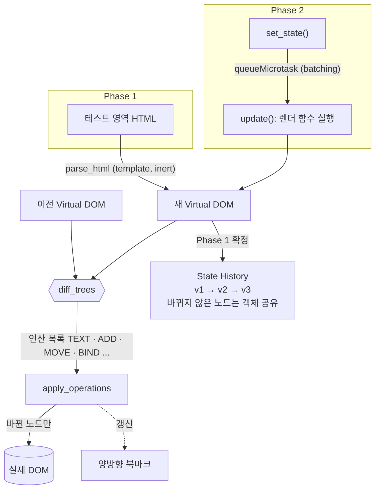
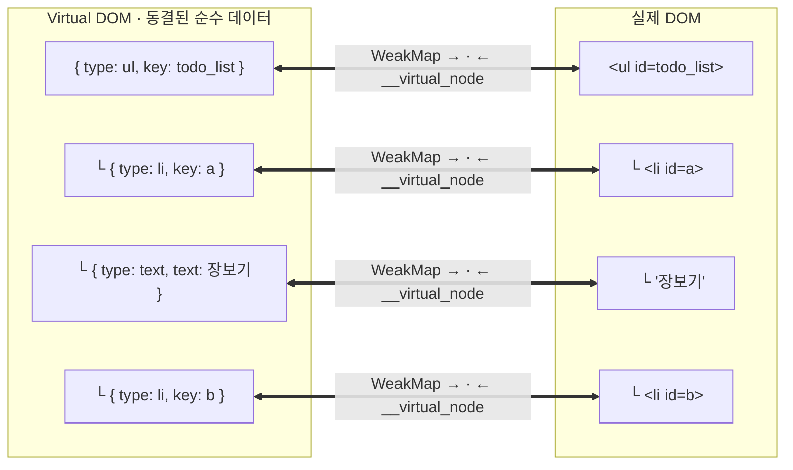

<div align="center">


<p>
  <a href="#아키텍처"><b>아키텍처</b></a> ·
  <a href="#phase-1--virtual-dom--diff--patch"><b>Phase 1</b></a> ·
  <a href="#phase-2--component--state--hooks"><b>Phase 2</b></a> ·
  <a href="#3-patch--양방향-북마크"><b>양방향 북마크</b></a> ·
  <a href="#실제-react와-비교"><b>React와 비교</b></a> ·
  <a href="#ai-활용-방식"><b>AI 활용</b></a> ·
  <a href="#벤치마크"><b>벤치마크</b></a>
</p>

</div>

**바뀐 노드만, 트리를 다시 훑지 않고 바로 찾아서 고칩니다.** Mini React는 화면을 Virtual DOM으로 들고 있다가 두 트리의 차이만 실제 DOM에 반영합니다. 책에 붙이는 인덱스처럼 Virtual DOM 노드와 실제 DOM 노드를 서로 가리키는 [양방향 북마크](#3-patch--양방향-북마크) 덕분에, patch는 바뀐 노드 수에만 비례하고 입력 중인 값과 포커스는 그대로 남습니다.

## 목차

- [아키텍처](#아키텍처)
- [핵심 로직](#핵심-로직)
  - [Phase 1 — Virtual DOM · Diff · Patch](#phase-1--virtual-dom--diff--patch)
  - [Phase 2 — Component · State · Hooks](#phase-2--component--state--hooks)
- [사용법](#사용법)
- [테스트](#테스트)
- [실제 React와 비교](#실제-react와-비교)
- [AI 활용 방식](#ai-활용-방식)
- [벤치마크](#벤치마크)
- [Contributing](#contributing)

## 아키텍처



| 모듈 | 하는 일 |
|---|---|
| [`virtual_node.js`](src/virtual_node.js) | 노드 정의, 실제 DOM → Virtual DOM 변환, 위험한 요소·attribute 차단 |
| [`parse_html.js`](src/parse_html.js) | HTML 문자열 → Virtual DOM (`<template>` 사용, 스크립트 실행 없음) |
| [`diff.js`](src/diff.js) | 두 트리를 비교해 연산 목록 생성, 노드 공유 |
| [`patch.js`](src/patch.js) | 연산을 실제 DOM에 적용, 양방향 북마크 관리 |
| [`state_history.js`](src/state_history.js) | 뒤로·앞으로·갈래 버리기 (최대 50개) |
| [`operation_summary.js`](src/operation_summary.js) | 연산 목록 → `2개 변경 반영 (TEXT 1, ADD 1)` |
| [`function_component.js`](src/function_component.js) | `FunctionComponent`와 Hooks |
| [`view_builder.js`](src/view_builder.js) | `create_view_element`, 이벤트 핸들러 보관 |
| [`song_board.js`](src/song_board.js) | Phase 2 예제 앱 (최애곡 모음) |

## 핵심 로직

### Phase 1 — Virtual DOM · Diff · Patch

<p align="center">
  
  <br />
  <sub>테스트 영역에서 HTML을 고치고 <b>Patch</b> → 바뀐 노드만 실제 영역에 반영되고 하이라이트됩니다. 오른쪽 State History로 뒤로·앞으로 이동합니다.</sub>
</p>

#### 1. Virtual DOM 노드

모든 노드는 `Object.freeze`로 동결한 순수 데이터입니다. 바뀐 내용이 있으면 노드를 고치지 않고 새 노드를 만듭니다(불변성).

```js
{ type: 'li',    key: 'a',  attributes: { id: 'a' }, children: [...], namespace: null } // id가 있으면 key
{ type: 'p',     key: null, attributes: {},          children: [...], namespace: null } // id가 없으면 위치로 비교
{ type: '#text', key: null, text: '안녕' }                                              // 텍스트도 객체
```

- **텍스트도 객체** — 북마크로 쓰는 `WeakMap`은 객체만 키로 받기 때문입니다.
- **namespace** — SVG처럼 HTML이 아닌 요소는 `namespace`를 저장해 `createElementNS`로 만듭니다.
- **안전한 변환** — `script`, `base`, `meta`, `object`, `embed` 요소와 `on*` attribute, `javascript:` URL은 변환 단계에서 제외합니다.

#### 2. Diff — 7가지 연산

| 연산 | 언제 |
|---|---|
| `TEXT` | 텍스트·주석 내용만 바뀜 |
| `ATTRIBUTES` | 같은 요소의 attribute가 추가·변경·삭제됨 |
| `ADD` | 새 노드가 생김 |
| `REMOVE` | 노드가 사라짐 |
| `REPLACE` | 같은 자리의 노드 종류(태그)가 바뀜 |
| `MOVE` | `id`(key)가 같은 노드의 순서가 바뀜 |
| `BIND` | 내용이 같아 DOM은 그대로 두고 북마크만 옮김 |

자식은 다음 순서로 짝짓습니다.

1. **`id`가 같은 노드끼리** — 순서가 바뀌면 지우고 다시 만드는 대신 `MOVE`로 옮깁니다.
2. **내용이 완전히 같은 노드끼리** — 들여쓰기 공백 하나 때문에 뒤쪽 노드가 전부 바뀐 것으로 잡히지 않습니다.
3. **남은 노드는 위치대로** — 종류가 다르면 `REPLACE`로 처리합니다.

#### 3. Patch — 양방향 북마크

##### 💡 아이디어는 책 읽는 습관에서 나왔습니다

책을 읽을 때 중요한 페이지에 인덱스 스티커를 붙여 두면, 다시 찾을 때 첫 장부터 넘기지 않고 바로 그 페이지를 펼칠 수 있습니다. patch도 똑같은 문제를 겪습니다. 바뀐 노드를 고치려면 실제 DOM에서 그 노드를 찾아야 하는데, 매번 루트부터 트리를 따라 내려가는 건 책을 첫 장부터 넘기는 것과 같습니다.

그래서 **"노드에도 인덱스를 붙여 두면 어떨까?"** 하는 아이디어가 나왔고, 이를 양방향 북마크로 구현했습니다.

| 책 | Mini React |
|---|---|
| 책의 한 페이지 | Virtual DOM 노드 하나 |
| 페이지에 붙인 인덱스 스티커 | 북마크 (Virtual DOM 노드 → 실제 DOM 노드) |
| 스티커를 보고 바로 펼치기 | patch가 대상 DOM을 트리 순회 없이 바로 찾기 |
| 개정판이 나오면 스티커를 새 책으로 옮겨 붙이기 | `BIND` — 내용이 같으면 북마크만 새 노드로 옮기기 |
| 버린 책의 스티커는 함께 사라짐 | `WeakMap` — 버려진 노드의 북마크는 GC가 회수 |

##### 구조

Virtual DOM 노드와 실제 DOM 노드를 **양쪽에서 서로 가리키는** 연결입니다. 노드는 순수 데이터로 두고, 연결 정보는 노드 밖에 둡니다.



| 방향 | 저장 위치 | 쓰는 곳 |
|---|---|---|
| Virtual DOM → DOM | `WeakMap` | patch가 고칠 DOM을 트리 순회 없이 바로 찾음 |
| DOM → Virtual DOM | `dom_node.__virtual_node` | 이벤트 대상 DOM에서 노드와 핸들러를 바로 찾음 |

##### 왜 위치 대신 노드를 가리키나

연산이 "부모의 2번째 자식의 0번째 자식"처럼 **위치**를 가리키면, patch는 매번 루트부터 경로를 따라 내려가야 하고 앞쪽 연산이 DOM을 바꾸면 뒤쪽 경로가 틀어집니다. Mini React의 연산은 위치 대신 **이전 트리의 노드 객체**를 가리킵니다. patch는 그 객체로 `WeakMap`을 조회해 대상 DOM을 바로 얻습니다.

```
  diff 결과:  { kind: 'TEXT', old_node: ●, text: '운동하기' }
                                        │
                                        ▼  WeakMap.get(●)
  patch:      '장보기' 텍스트 DOM  →  .data = '운동하기'
```

##### 북마크의 일생

북마크는 [`patch.js`](src/patch.js) **한 곳에서만** 바뀝니다.

| 시점 | 연산 | 북마크 |
|---|---|---|
| 처음 그릴 때 | `mount_tree` → `create_dom_tree` | 만든 DOM마다 양방향 연결 |
| 내용이 같은 노드 | `BIND` | DOM은 그대로, 연결만 새 Virtual DOM 노드로 옮김 |
| 내용이 바뀐 노드 | `TEXT` `ATTRIBUTES` `MOVE` | 이전 노드로 DOM을 찾아 고침 |
| 새 노드 | `ADD` `REPLACE` | 새 DOM을 만들며 연결 |
| 사라진 노드 | `REMOVE` `REPLACE` | 하위 트리 전체를 끊음 (`unbind_subtree`) |
| 정리 | `unmount_tree` | 컨테이너까지 모두 끊음 |

- **비용** — diff는 여전히 트리 전체를 봅니다(O(n)). patch는 바뀐 노드 수 k에만 비례합니다(O(k)).
- **입력값 보존** — 바뀌지 않은 노드는 DOM을 건드리지 않으므로 입력 중인 값과 포커스가 그대로 남습니다.
- **안전장치** — 같은 노드 객체를 트리 두 곳에 넣으면 북마크가 DOM 하나만 가리킬 수 있으므로 렌더링 단계에서 막습니다.

#### 4. State History — 브라우저 방식 이력

```
  v1 → v2 → v3          현재 v3
  뒤로가기               현재 v2   (v3은 앞으로가기로 돌아갈 수 있음)
  수정 후 Patch          v1 → v2 → v4   (v3은 버림)
```

- **전체 트리 저장** — 각 상태가 루트부터 완전한 트리라서 어느 시점으로든 바로 이동합니다.
- **노드 공유** — 바뀌지 않은 노드는 이전 트리와 같은 객체를 가리킵니다. 새로 만드는 건 바뀐 노드와 그 조상뿐입니다.
- **이동도 diff로** — 뒤로·앞으로 갈 때도 두 트리의 차이만 patch해서 입력값과 포커스를 보존합니다.
- **저장 규칙** — 수정 없이 Patch하면 아무것도 저장하지 않고, 최대 50개까지 보관합니다.

### Phase 2 — Component · State · Hooks

<p align="center">
  
  <br />
  <sub><code>FunctionComponent</code>로 만든 최애곡 모음 앱. <code>set_state</code> 한 번이면 화면이 자동으로 다시 그려지고, 바뀐 노드가 하이라이트됩니다.</sub>
</p>

#### `FunctionComponent`

| 멤버 | 역할 |
|---|---|
| `hooks` | Hook의 값을 호출 순서대로 담는 배열 |
| `mount()` | 처음 렌더링 |
| `update()` | State 변경 후 다시 렌더링 |
| `unmount()` | effect 정리 함수 실행, 리스너·DOM·북마크 정리 |

```
  update():  hook 위치 0 → 렌더 함수 실행 → diff → patch(북마크 갱신) → effect 실행
```

#### 함수는 매번 새로 실행되는데 상태는 어떻게 유지할까?

상태는 함수 안이 아니라 `hooks` 배열에 있습니다. 렌더링마다 위치를 0으로 되돌리고, Hook을 부를 때마다 한 칸씩 나아가며 같은 칸의 값을 꺼냅니다.

```
  hooks[0]  { state: songs }          ← use_state(initial_songs)
  hooks[1]  { state: filter_name }    ← use_state('all')
  hooks[2]  { memo:  visible_songs }  ← use_memo(..., [songs, filter_name])
  hooks[3]  { effect: save_board }    ← use_effect(..., [songs])
```

> [!IMPORTANT]
> Hook의 호출 순서는 렌더링마다 같아야 합니다. 조건문·반복문 안에서 Hook을 부르거나, 자식 컴포넌트에서 Hook을 부르면 오류를 냅니다.

#### Hooks

| Hook | 하는 일 |
|---|---|
| `use_state(initial_state)` | `[현재 값, set_state]`. 같은 값(`Object.is`)이면 다시 그리지 않습니다. |
| `use_effect(callback, dependencies)` | patch가 끝난 뒤 의존성이 바뀌었을 때만 실행합니다. 정리 함수는 다음 실행 전과 `unmount()` 때 부릅니다. |
| `use_memo(callback, dependencies)` | 의존성이 같으면 이전 계산 값을 그대로 돌려줍니다. |

- **Batching** — `set_state`를 여러 번 불러도 `queueMicrotask`로 `update()`를 한 번만 예약합니다.
- **Lifting State Up** — State는 루트에만 둡니다. 자식은 `render_child_component`로 부르는 순수 함수이고, `props`는 동결해서 넘깁니다.
- **이벤트 위임** — 리스너는 컨테이너 하나에만 붙입니다. 이벤트가 오면 `대상 DOM → __virtual_node → 핸들러` 순서로 찾습니다. 북마크가 늘 최신 노드를 가리키므로 마지막 렌더링의 핸들러가 불립니다.

## 사용법

```js
import { FunctionComponent, use_state, use_effect, render_child_component } from './src/function_component.js';
import { create_view_element as element } from './src/view_builder.js';

// 자식: State 없이 props만 받는 순수 함수
function counter_label(props) {
  return element('p', null, [`눌린 횟수: ${props.count}`]);
}

// 루트: Hook과 State는 여기서만
function counter_root() {
  const [count, set_count] = use_state(0);

  use_effect(() => {
    document.title = `count ${count}`;
  }, [count]);

  return element('section', null, [
    render_child_component(counter_label, { count }),
    element('button', {
      attributes: { type: 'button' },
      event_handlers: { click: () => set_count((previous_count) => previous_count + 1) },
    }, ['+1']),
  ]);
}

new FunctionComponent(counter_root, document.querySelector('#app')).mount();
```

<details>
<summary><b>create_view_element 규칙</b></summary>

`create_view_element(태그, { attributes, event_handlers, namespace }, 자식들)`

- 자식으로 문자열·숫자(텍스트), 노드, 배열(펼침)을 넣을 수 있고 `null`·`false`는 건너뜁니다.
- attribute 값이 `true`면 빈 불리언 attribute, `false`·`null`이면 attribute를 만들지 않습니다.
- 이벤트 핸들러는 노드 밖 `WeakMap`에 저장하므로 diff 대상이 아닙니다.
- `script`, `base`, `meta`, `object`, `embed` 요소와 `on*` attribute, `javascript:` URL은 만들지 않습니다.

</details>

## 테스트

```bash
npm test
```

| 구분 | 내용 |
|---|---|
| 단위 | `node:test` + `node:assert/strict`, 15개 모듈 · **209개 통과** |
| DOM 대역 | jsdom 없이 직접 만든 [`test/support/fake_dom.js`](test/support/fake_dom.js) |
| 엣지 케이스 | 모듈마다 [`docs/testing/<모듈>.md`](docs/testing)에 엣지 케이스 · 유닛 테스트 · 미검증 항목 표 |
| 브라우저 | 대역으로 확인할 수 없는 레이아웃 · 포커스 · 렌더링은 Playwright MCP로 2차 검증 |

<details>
<summary><b>검토한 엣지 케이스 예시</b></summary>

- `id` 없음 · 중복 · 변경, 들여쓰기 공백 · 주석만 바뀐 경우
- 처음에서 뒤로가기, 뒤로 간 상태에서 수정 없이 Patch
- `<script>`, `onclick`, `javascript:` URL, SVG `animate`로 `href` 바꾸기 (XSS)
- SVG · MathML namespace, 깊은 중첩과 대량 노드
- 렌더링 중 `set_state`, 조건문 안의 Hook, effect 안에서 `unmount()`

</details>

## 실제 React와 비교

| 항목 | React | Mini React |
|---|---|---|
| 화면 기술 | JSX | `create_view_element` 함수 호출 |
| State 위치 | 모든 컴포넌트 | 루트 컴포넌트만 (자식은 props만) |
| 비교 범위 | setState한 컴포넌트의 서브트리 | 루트부터 전체 트리 |
| 렌더링 | 중단·재개 가능 (Fiber) | 한 번에 동기 실행 |
| DOM 연결 | Fiber 노드가 참조 보유 | 노드 밖 `WeakMap` + `__virtual_node` |
| key | `key` prop | `id` attribute |
| 과거 상태 | 기본 기능 없음 | State History (뒤로·앞으로) |
| 의존성 | `react`, `react-dom` | 없음 |

### 장점

- **흐름 전체를 읽을 수 있음** — 핵심 코드가 수백 줄 단위라 `set_state`부터 실제 DOM 변경까지 한 번에 따라갈 수 있습니다.
- **patch 대상을 바로 찾음** — 양방향 북마크로 바뀐 노드의 DOM을 트리 순회 없이 찾습니다.
- **과거 상태로 이동** — State History가 기본으로 들어 있어 뒤로·앞으로 이동과 변경 요약을 바로 볼 수 있습니다.
- **예측하기 쉬운 실행** — 렌더링이 동기로 끝나고 Hook 순서·자식 Hook 위반을 즉시 오류로 알려 줘서 디버깅이 쉽습니다.
- **기본이 안전함** — `<script>`, `on*` attribute, `javascript:` URL을 변환 단계에서 막습니다.

### 단점

- **State가 루트에만 있음** — 상태가 많아지면 루트 컴포넌트가 커지고, props를 여러 단계로 내려야 합니다.
- **항상 전체 트리를 비교** — 작은 State 변경에도 루트부터 diff합니다. React는 바뀐 컴포넌트 아래만 다시 렌더링합니다.
- **렌더링을 나누지 못함** — Fiber 같은 중단·우선순위가 없어 아주 큰 트리에서는 한 프레임을 오래 붙잡을 수 있습니다.
- **JSX가 없음** — 화면을 함수 호출로 써야 해서 코드가 길어집니다.
- **key가 `id`에 묶임** — `id`가 없는 목록은 순서가 바뀌면 `MOVE` 대신 내용 변경(`TEXT`, `REPLACE`)으로 처리될 수 있습니다.
- **생태계가 없음** — 개발자 도구, 라우터, 서버 렌더링 같은 주변 도구가 없습니다.

## AI 활용 방식

AI(Claude Code)를 코드 생성기가 아니라 **규칙을 지키는 페어 프로그래머**로 썼습니다. 규칙은 문서로 먼저 정하고, AI의 결과는 테스트와 문서로 검증했습니다.

- **규칙을 문서로 고정** — [`CLAUDE.md`](CLAUDE.md)에 의존성 금지, `snake_case` 이름, `node:test`만 사용, 엣지 케이스 문서화 같은 규칙을 적어 두고 모든 작업에 적용했습니다.
- **요구사항은 사람이 정함** — 과제 요구사항([`phase2.md`](phase2.md))과 설계([`plan.md`](plan.md), [`design.md`](design.md))는 팀이 정하고, AI는 그 범위 안에서 구현했습니다.
- **테스트 먼저** — 버그는 실패하는 테스트로 먼저 재현하고, Red 단계 실패 기록은 [`docs/troubleshooting`](docs/troubleshooting)에 남겼습니다.
- **엣지 케이스 검토** — 입력 · 환경 · 변경 · 이벤트 · 보안 체크리스트로 기능마다 엣지 케이스를 뽑고 `EC-001` 형식 ID로 테스트와 연결했습니다.
- **2단계 검증** — 1차는 직접 만든 DOM 대역으로 유닛 테스트, 2차는 대역으로 확인할 수 없는 항목을 Playwright MCP로 실제 브라우저에서 확인했습니다.

<!-- TODO: 팀에서 AI를 어떻게 나눠 썼는지, 잘 됐던 점 / 직접 고쳐야 했던 점을 추가 -->

## 벤치마크

<!-- TODO: 북마크 on/off patch 시간 비교, 노드 공유 메모리 비교 등 -->

## Contributing

- `main`에 직접 push하지 않는다. 브랜치 → PR → 리뷰 1명 승인 → merge
- 브랜치: `feat/<주제>`, `fix/<주제>`, `docs/<주제>`
- 커밋: `[Feat]` `[Fix]` `[Test]` `[Docs]` `[Refactor]` `[Chore]` + 제목, 빈 줄, 한 줄 설명
- 이슈 1개 ↔ PR 1개. PR 본문에 `Closes #이슈번호`
