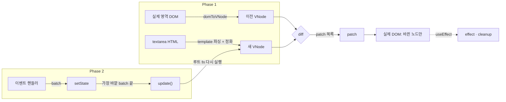

# Mini React

> **Krafton Jungle WEEK11-12 · Team 11** — [mini-react](https://github.com/cc8s/jungle-team11-mini-react) · [mini-redis](https://github.com/cc8s/jungle-team11-mini-redis) · [mini-dbms](https://github.com/cc8s/jungle-team11-mini-dbms) · [보드](https://github.com/users/cc8s/projects/9)

Virtual DOM · Diff · Patch 와 함수형 Component · Hooks(`useState` / `useEffect` / `useMemo`) · batching 을 **Vanilla JS 로 직접 구현**한 미니 리액트.

- 데모: https://cc8s.github.io/jungle-team11-mini-react/
  - **Phase 1**: 테스트 영역(textarea)의 HTML 을 고치고 Patch → 실제 영역에는 바뀐 노드만 반영. 뒤로 / 앞으로, Patch 로그(MutationObserver)
  - **Phase 2**: 오목. 클릭 1번에 렌더 몇 번, patch 몇 개가 일어났는지 화면에 표시

## 실행 방법

```bash
npm install
npm run dev     # 개발 서버
npm test        # 단위·통합 테스트 (npm run test:e2e 는 Playwright)
```

> **Vite 는 개발 서버와 번들러일 뿐, 런타임 프레임워크가 아니다.** 런타임 의존성은 0개이고 화면을 그리는 코드는 전부 `src/` 에 직접 작성했다.

## 아키텍처



| 폴더 | 역할 |
|---|---|
| `src/vdom/` | `vnode`(h) · `dom-to-vnode` · `render` · `diff` · `patch` |
| `src/core/` | `component`(FunctionComponent) · `hooks` · `scheduler`(batching) |
| `src/phase1/` | Phase 1 데모: 정화, History, Patch 로그 |
| `src/app/` | Phase 2 데모: 오목 |

## 핵심 로직

### 1. VNode — 요소와 텍스트를 같은 모양으로

```js
{ type: 'div',   props: { id: 'a' }, key: null, children: [...] }
{ type: '#text', props: {},          key: null, children: [], text: 'hi' }
```

모양이 같아서 diff 가 "type → text → props → children" 순서로 한 줄씩 내려가며 비교할 수 있다.
실제 DOM 을 읽을 때 공백만 있는 텍스트 노드와 주석은 버린다(`<pre>`, `<textarea>` 안은 남긴다).

### 2. Diff — 결정 테이블 순서로 판단

| 순서 | 조건 | 결과 |
|---|---|---|
| 1 | 이전 노드 없음 | `ADD` |
| 2 | 새 노드 없음 | `REMOVE` |
| 3 | type 또는 key 가 다름 | `REPLACE` (그 아래는 비교하지 않음) |
| 4 | 텍스트 노드인데 내용이 다름 | `TEXT` |
| 5 | 속성이 다름 | `PROPS` (`set` / `remove`) → 자식으로 재귀 |

- patch 마다 루트에서 대상까지의 `path`(자식 인덱스 배열)를 붙인다.
- 남는 자식은 ADD 는 앞에서부터, REMOVE 는 **뒤에서부터** 낸다. 앞에서 지우면 뒤 인덱스가 밀리기 때문이다.

### 3. Patch — 바뀐 곳만 건드린다

`TEXT` 는 텍스트 노드의 `data` 만, `PROPS` 는 속성만 바꾸고 노드를 교체하지 않는다.
그래서 제어 input 에 타이핑하는 도중 글자마다 리렌더돼도 입력이 끊기지 않는다(`E2E-HOOK-008`).

### 4. Hooks — 함수는 매번 다시 실행되는데 상태는 어떻게 남나

상태는 함수 안이 아니라 **컴포넌트 인스턴스의 `hooks` 배열**에 있다.

```
렌더 시작: hookIndex = 0
useState()  → hooks[0]   (처음이면 초깃값으로 칸을 만들고, 아니면 있던 칸을 돌려준다)
useMemo()   → hooks[1]
useEffect() → hooks[2]
```

hook 은 **부르는 순서**로 자기 칸을 찾는다. 그래서 조건문 안에서 hook 을 부르면 안 되고,
이 구현은 첫 렌더와 개수나 종류가 다르면 오류를 낸다. Hook 은 루트 컴포넌트에서만 쓰고, 자식은 props 만 받는 순수 함수다.

- `useEffect`: 렌더 중에는 "이번에 실행할지"만 기록하고, DOM 반영이 끝난 뒤 이전 cleanup → 새 effect 순서로 실행한다.
- `useMemo`: deps 를 `Object.is` 로 비교해 같으면 이전 값을 돌려준다.

### 5. batching — 클릭 1번 = 렌더 1번

오목 클릭 1번에 state 가 2개(판, 수순) 바뀐다. 묶지 않으면 렌더가 2번이고, 그 사이 "판은 새것, 수순은 옛것"인 중간 상태로 effect 가 돌아 URL 기록이 2칸 쌓인다.

`render.js` 가 등록하는 이벤트 리스너는 핸들러를 `batch()` 로 감싼다. 안의 setState 는 "다시 그려야 함"으로 표시만 하고, 가장 바깥 batch 가 끝날 때 한 번 렌더한다.

### 측정: 오목 클릭 1번 (19×19 = 361칸)

| 방식 | 렌더 | DOM 변경 |
|---|---|---|
| 레퍼런스(innerHTML 로 판 전체 재생성) | 1 | 361칸 전부 새로 만듦 |
| 이 구현, 핸들러를 매 렌더 새로 만들 때 | 1 | 361칸 모두 `PROPS` |
| 이 구현, 핸들러를 `useMemo` 로 고정 | **1** | **patch 3개** |
| 이 구현, batching 을 끈 경우 | 2 | 두 렌더의 합 |

근거 테스트: `TC-APP-020`, `TC-APP-030`, `TC-APP-031` (`tests/integration/`)

## 테스트

| 레벨 | 도구 | 수 | 내용 |
|---|---|---|---|
| 컴포넌트 | Vitest + jsdom (`tests/unit`) | 457 | vnode, dom→vnode, render, diff, patch, hooks, batching, 오목 규칙 |
| 통합 | Vitest + jsdom (`tests/integration`) | 128 | DOM → VNode → diff → patch, setState → update → patch, 데모 화면 |
| 시스템 | Playwright Chromium (`tests/e2e`) | 33 | 실제 브라우저에서 입력·클릭·뒤로가기, 스크립트 실행 차단 |

설계 기법은 결정 테이블(Diff 5 케이스), 경계값, 상태 전이(History, mount → update → unmount), 에러 추측(엣지 케이스)을 썼다. 테스트 이름은 `TC-<모듈>-<번호>` 이다.

엣지 케이스 예:

| 입력 | 기대 |
|---|---|
| 같은 위치에서 key 만 다름 | `REPLACE` |
| `title` 과 `Title` (HTML 은 대소문자 무시, SVG `viewBox` 는 구분) | 한 속성으로 비교 |
| 사용자가 실제 영역에서 체크·입력한 뒤 Patch | VNode 값으로 되돌림 |
| `<script>`, `javascript:` href, `data:` iframe, meta refresh | 실행·이동되지 않음 (허용 목록 정화) |
| 업데이터 안에서 setState / 조건부 hook | 오류 |
| 렌더 중 setState 무한 반복 | 25회에서 중단 |

## 실제 React 와의 차이

| | 이 구현 | React |
|---|---|---|
| 자식 비교 | 같은 인덱스끼리. key 가 다르면 교체 | key 로 짝지어 **이동** |
| Hook 위치 | 루트 컴포넌트에서만 | 모든 컴포넌트 |
| batching 범위 | 이벤트 핸들러 안 (React 17 과 같은 범위) | React 18 은 microtask 단위라 `setTimeout`·Promise 안의 setState 도 묶는다 |
| 이벤트 | 요소마다 리스너 | 루트에 위임한 리스너 하나 |
| 렌더 | 동기, 한 번에 끝까지 | Fiber: 쪼개서 중단·재개 가능 |

> React 18 이 microtask 로 바꾼 이유: 비동기 코드 안의 setState 까지 자동으로 묶기 위해서다. 이 구현은 기존 동기 동작과 테스트를 깨지 않으려고 이벤트 단위를 택했다.

## 한계와 다음 단계

- **버블링이면 렌더 2번**: 자식과 부모 핸들러가 모두 setState 하면 핸들러마다 렌더한다. 리스너를 요소마다 붙여 dispatch 가 끝나는 시점을 알 수 없기 때문이다. 루트 위임으로 바꾸면 해결된다.
- **같은 수순, 다른 URL 이면 "렌더 1 · patch 0"**: popstate 리스너는 다시 그릴지를 **URL 문자열**(`location.search`)로 판단한다. 그래서 문자열은 다르지만 수순은 같은 기록(쿼리 없음 ↔ 빈 판 `?a=W10=`, `?a=X` ↔ `?a=X&utm=1`)으로 이동하면 같은 수순을 새 배열로 setState 한다. 배열은 `Object.is` 로 다르니 렌더는 일어나지만, 판이 같아 diff 결과는 0 개다. 판은 정상이고 통계만 "렌더 1 · patch 0" 이 된다. 데모 버튼(클릭·초기화·뒤로·앞으로)만으로는 길이 4 까지의 680 가지 순서에서 재현되지 않았고, 앱이 직접 만들지 않은 같은 문서 안의 기록이 있을 때 생긴다. 해결: URL 을 디코딩한 수순끼리 비교한다.
- key 기반 자식 재정렬(이동)은 없다. 리스트 앞에 하나를 넣으면 뒤가 전부 바뀐다.

## 출처

- Phase 2 오목 판 CSS(19×19 교차점 격자)와 `?a=base64(JSON)` URL 저장 방식: [codingapple1/gibo](https://github.com/codingapple1/gibo). 판 편집기를 오목으로 바꾸고, 판 대신 수순을 저장해 수순 번호를 복원했다.
- 디자인 규칙: [`docs/design.md`](docs/design.md)

## 개발 방식

구현은 AI 에이전트가 주도했다. 대신 AI 가 틀려도 잡히는 구조(테스트 먼저 → 구현 → 병렬 리뷰 → 실행으로 재현한 것만 채택)를 만들고 그 효과를 측정했다. 자세한 내용은 [`docs/ai-workflow.md`](docs/ai-workflow.md).

## Contributing

- `main`, `develop` 에 직접 push 하지 않는다. 브랜치 → PR → CI `test` 통과 → 리뷰 승인 → merge
- 흐름: `<id>/feat/<모듈>` → `<id>/main` → `develop` → `main`(GitHub Pages 배포)
- 커밋: `[Feat]` `[Fix]` `[Test]` `[Docs]` `[Refactor]` `[Chore]` + 제목, 빈 줄, 한 줄 설명
- PR 본문은 `.github/pull_request_template.md` 를 따른다
