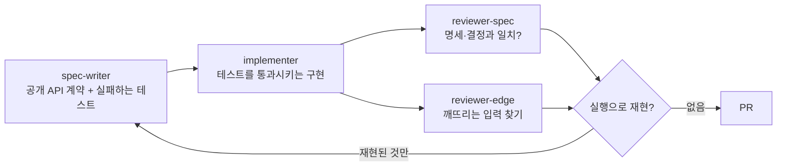

# AI 로 개발한 방식

이 레포의 구현은 AI 에이전트(Claude Code)가 주도했다.
목표는 "AI 로 짰다"가 아니라 **AI 가 틀려도 잡히는 구조를 만들고, 그 구조가 실제로 무엇을 잡았는지 측정하는 것**이었다.

## 1. 파이프라인: 쓰는 쪽과 검사하는 쪽을 나눈다

| 단계 | 할 수 있는 일 | 할 수 없는 일 |
|---|---|---|
| spec-writer | `tests/` 작성 (Red 상태로 끝남) | `src/` 수정 |
| implementer | `src/` 작성 | `tests/` 수정. 테스트가 틀렸다고 보면 **이의**를 내고 사람이 판단 |
| reviewer 2개 (병렬) | 읽기만 | 파일 수정 |

- 리뷰 발견은 **실행으로 재현한 것만** 채택했다. 재현되지 않은 지적은 오탐으로 기록했다.
- 수정이 끝나면 **재리뷰**를 한 번 더 돌렸다. 수정이 새 결함을 만드는지 보기 위해서다.
- #2·#3 은 단일 세션으로 구현해 대조군으로 두었다.

## 2. 하네스: 규칙을 말이 아니라 장치로 강제한다

에이전트 설정과 hook 은 레포 밖에 두었다. 이 레포에는 결과물만 있다.

| 장치 | 하는 일 |
|---|---|
| 위험한 git 명령 차단 | force push, AI 설정 파일 add 등을 실행 전에 막는다 |
| 에이전트별 쓰기 범위 | implementer 가 `tests/` 를 고치거나 셸로 우회하면 막는다 |
| 편집 후 테스트 | 파일을 고칠 때마다 관련 테스트를 자동으로 돌린다 |
| 종료 게이트 | 테스트(e2e 포함)가 빨간 상태면 작업을 끝낼 수 없다 |

hook 이 막은 기록(의도적인 검증 시험 포함): git 명령 6, 쓰기 범위 6, implementer 종료 8, 메인 종료 4.

## 3. 측정 결과 (#4 ~ #11)

| 이슈 | 첫 시도 통과 | 리뷰가 실행으로 재현한 결함 |
|---|---|---|
| #4 Diff | 2/2 바퀴 | 5 |
| #5 Patch | 2/2 | 12 |
| #6 Phase 1 데모 | 2/2 | 12 (정화 우회 4건 포함) |
| #7 FunctionComponent | **1/2** | 12 |
| #8 useState | 3/3 | 7 + 재리뷰 6 |
| #9 useEffect · useMemo | 2/2 | 5 |
| #10 batching | 3/3 | 5 + 재리뷰 1 |
| #11 오목 데모 | 1/2 (첫 바퀴 571/573, 실패 2건은 테스트 오류로 인정) | 7 |
| **합** | | **72** |

## 4. 배운 것

- **"첫 시도에 테스트 통과"는 품질을 말해 주지 않았다.** 여덟 번 중 여섯 번 통과했지만, 리뷰는 **여덟 번 모두** 재현되는 결함을 찾았다. 커버리지 100% 인 `diff.js` 에서도 4건이 나왔다.
- **수정이 회귀를 만든다.** #8, #10 에서 결함을 고친 수정이 새 결함을 만들었고, 재리뷰만 그것을 잡았다.
- **검사하는 쪽도 틀린다.** #11 에서 implementer 가 spec-writer 의 테스트 오류 2건을 이의로 잡았다. 리뷰는 batching 을 꺼도 통과하는 "동어반복 테스트"를 찾아냈다.
- **블랙리스트는 뚫린다.** #6 정화에서 우회 4건이 재현되어 허용 목록 방식으로 바꿨다.
- **다른 모델을 리뷰어로 붙이는 것은 그 자체로 이득이 아니었다.** #4 블라인드 비교에서 힌트 없이 찾아낸 결함이 5건 중 1건이었다(Claude 는 4건). 그래서 쓰지 않았다.
